## Service Desk


---

<span>
<a href="./README.md">Русский</a> | English
</span>

---

Distributed SPA + API web application for managing orders, clients, employees, and implementing a three-stage deadline control system.

### UI screenshots

<details>

<summary>View</summary>

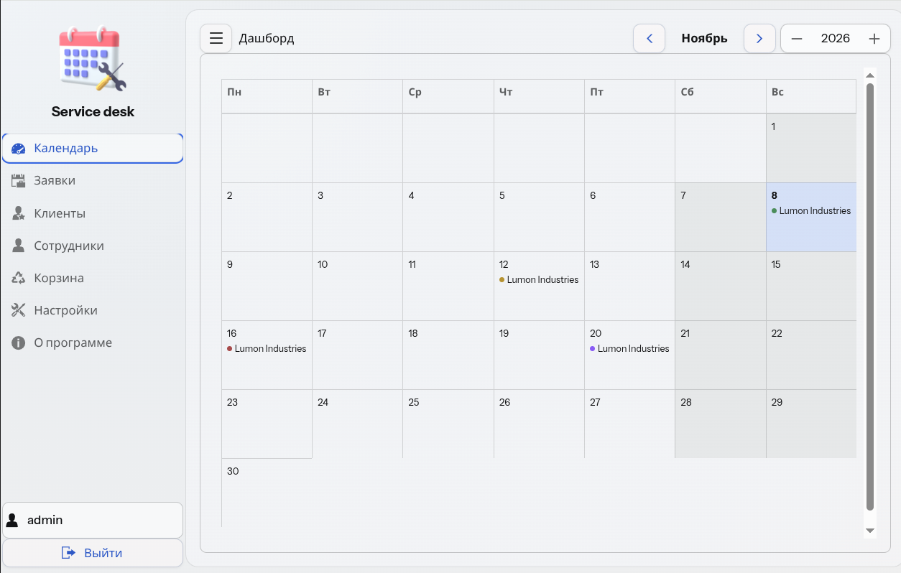
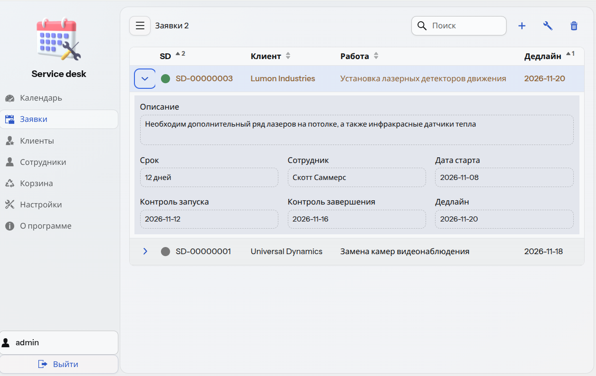
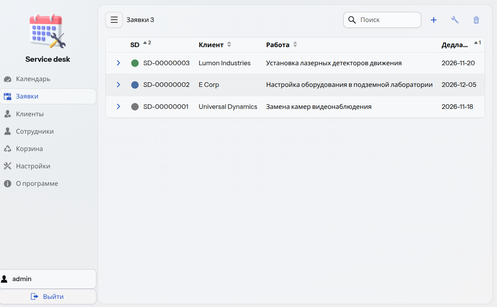
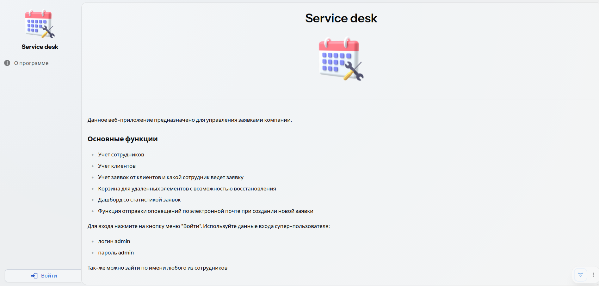

</details>

The interface theme automatically follows your browser theme.

### Main features
Only the following features have been implemented:
- [x] Employee management
- [x] Client management
- [x] Tracking customer requests and the employee assigned to each request
- [x] Recycle bin for deleted items with restore support
- [x] Traffic-light indicators for order status
- [x] Admin/user roles and login form
- [x] Dashboard with request statistics
- [x] Email notification sending when a new request is created
- [ ] Creating a new request via email

### Modules
- Backend (Hibernate, PostgreSQL)
- Frontend (Vaadin UI)

The modules interact with each other via gRPC (HTTP/2).

### Traffic-light status indicators
-  New request (NEW)
-  Time to start work (IN PROGRESS)
-  Time to check the initial stage (FIRST CONTROL)
-  Time to check the final stage (SECOND CONTROL)
-  Work on the request is complete (COMPLETED)

Additional color used in the calendar:
-  Deadline (DEADLINE)

### Requirements
Before starting, make sure the following tools are installed:

| Tool | Version | Check |
|------|---------|-------|
| Docker Desktop | 4.x+ | docker --version |
| Docker Compose | v2+ | docker compose version |
| JDK | 25 | java -version |
| Maven | 3.9+ | mvn -version |
| Node.js | 20+ (for local Vaadin builds) | node -v |
| Git | any | git --version |

### Running the application locally

Open a terminal and run the following commands:

**1. Clone the project**

```bash
git clone https://github.com/AleksOBM/vaadin-service-desk.git
```

**2. Go to the project root**

```bash
cd vaadin-service-desk
```

**3. Start the application**

The first launch may take 5–15 minutes.
Internet access is required to download dependencies and container images.

```bash
docker compose up --build -d
```

**4. Configure the certificate (optional)**

The access certificate is already included; export it through the browser and add it to the trusted certificates.

<details>

<summary>How to do this</summary>

4.1 After starting the application, open Chrome at https://localhost:8080.

<details>
<summary>A warning page will appear</summary>
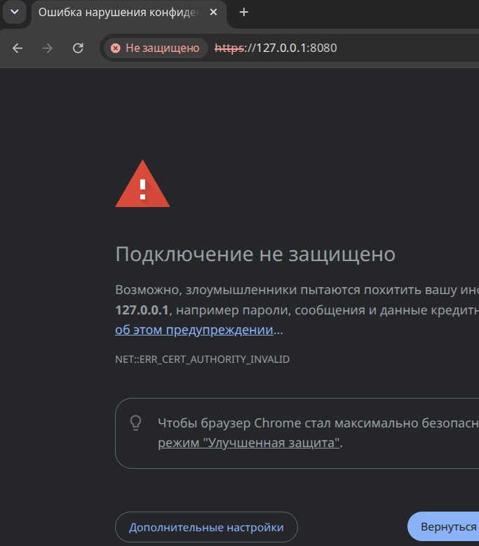
</details>

4.2 Click the warning, then select "Certificate details".

<details>
<summary>The certificate viewer will open</summary>
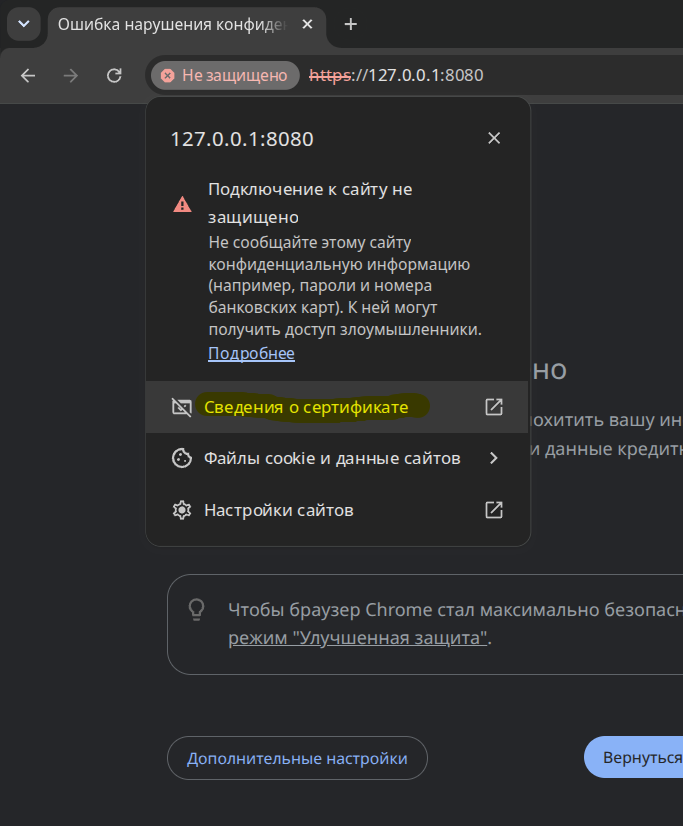
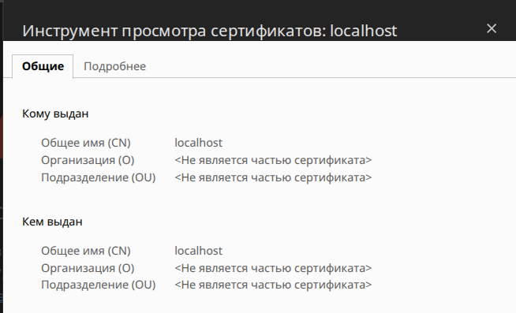
</details>

4.3 In the certificate details, open the "Details" tab and click "Export" at the bottom.

<details>
<summary>A file save dialog will appear</summary>
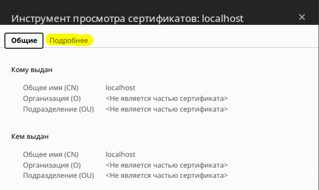
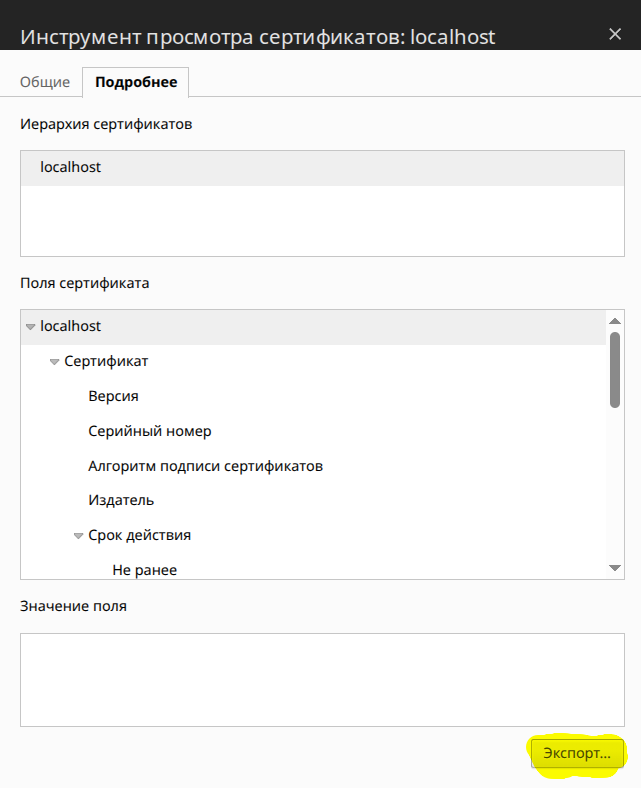
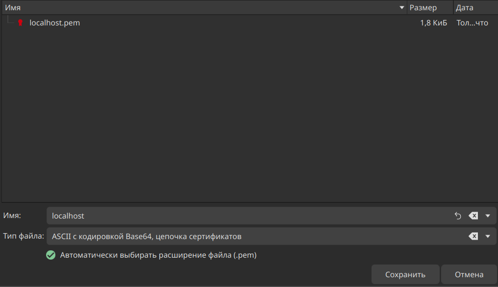
</details>

4.4 Add the exported certificate to your browser's trusted certificates.

4.4.1 Enter this address in the address bar:
`chrome://certificate-manager/localcerts/usercerts`

<details>
<summary>The certificate manager will open</summary>
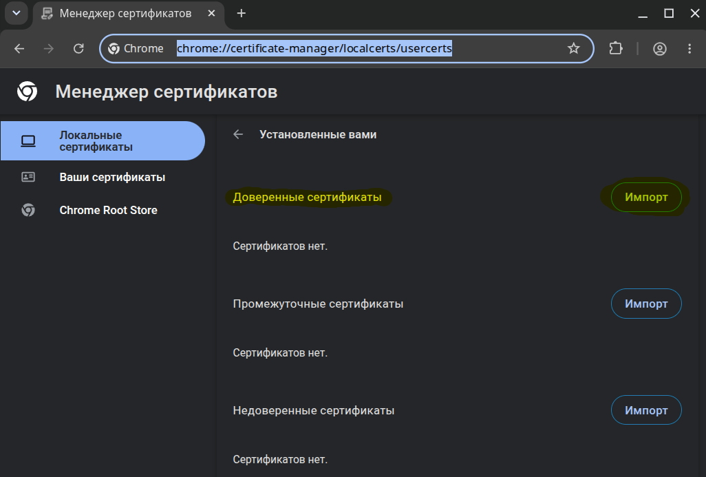
</details>

4.4.2 Click "Import".

<details>
<summary>A file selection dialog will appear</summary>
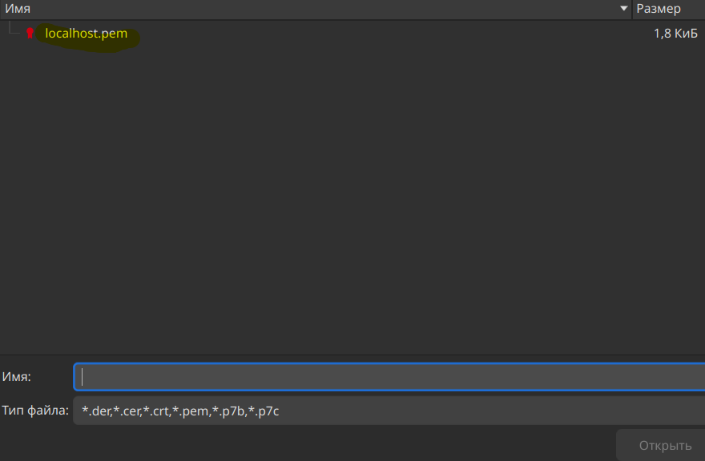
</details>

4.4.3 Select the certificate file and click "Open".

<details>
<summary>The certificate has been imported; you may delete the file afterward</summary>
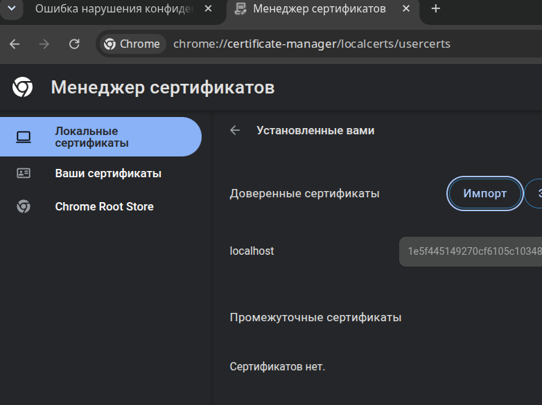
</details>

4.5 Restart Chrome.

</details>

**5. Using the application**

**If the certificate is configured**

Open your browser at https://localhost:8080.

<details>
<summary>View</summary>
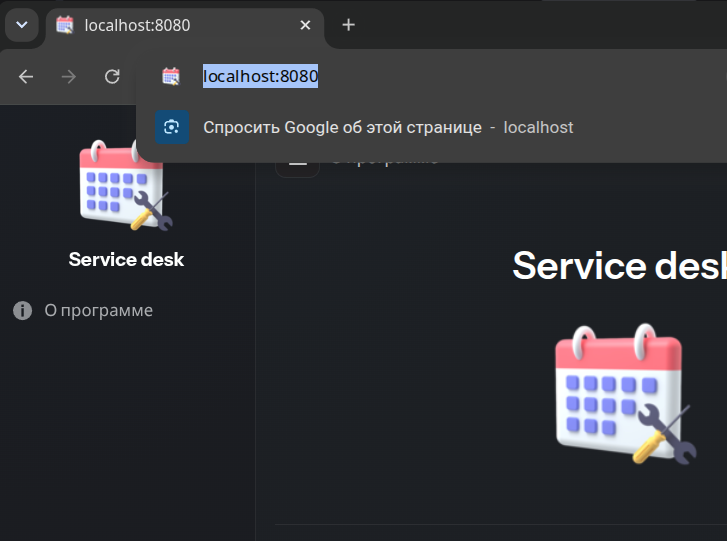
</details>

**If the certificate is not configured**

Open your browser at https://localhost:8080.

<details>
<summary>Ignore the browser certificate warning</summary>

When you first open the page, the browser will display a **"Your connection is not private"** warning.

<details>
<summary>View</summary>
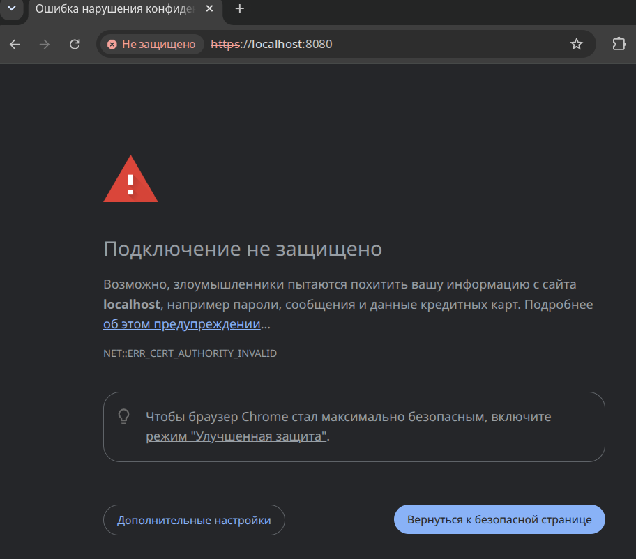
</details>

**This is normal for local network use.**

The project uses a self-signed certificate, which browsers do not trust by default.
Traffic is still encrypted.

**What to do:** click "Advanced" → "Proceed to localhost (unsafe)".

For public internet deployment, use a certificate issued by a trusted CA to avoid this warning.
</details>

**6. Stop**

Keep the data:

```bash
docker compose down
```

Without saving data:

```bash
docker compose down -v
```

**7. Start again**

```bash
docker compose up -d
```

**8. Remove everything completely**

```bash
docker compose down -v --rmi all
```

### Security configuration (for IT specialists)

[Instructions here](.docs/secrets.md)

### Email and automatic sending configuration (for administrators)

[Instructions here](.docs/mail_instructions.md)

### Frontend REST endpoints
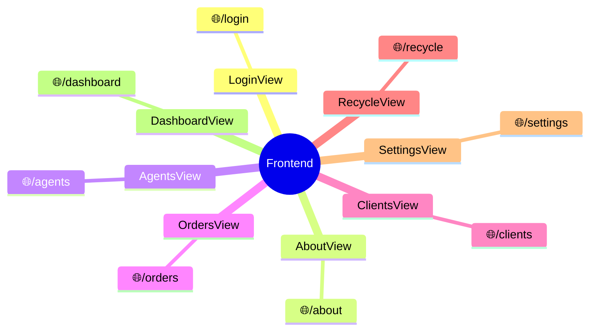

### Backend gRPC endpoints
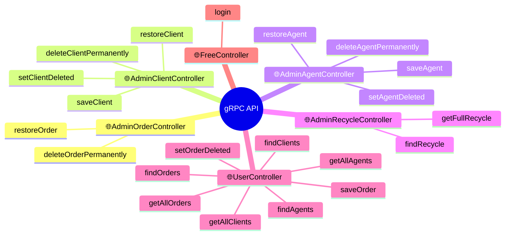

### Database schema

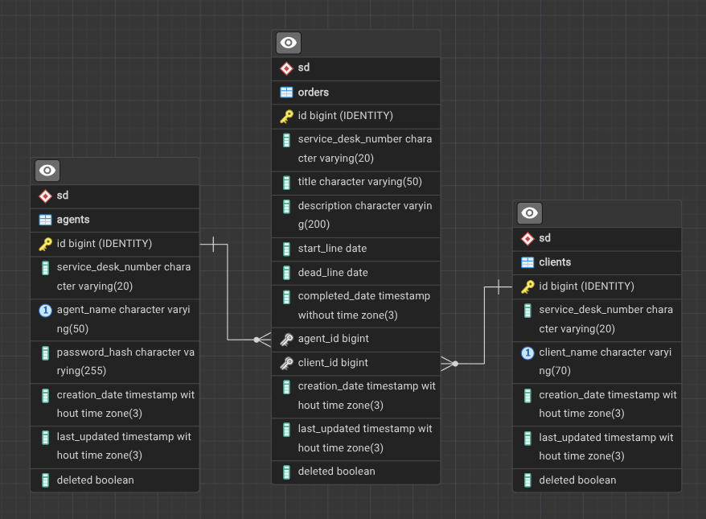
