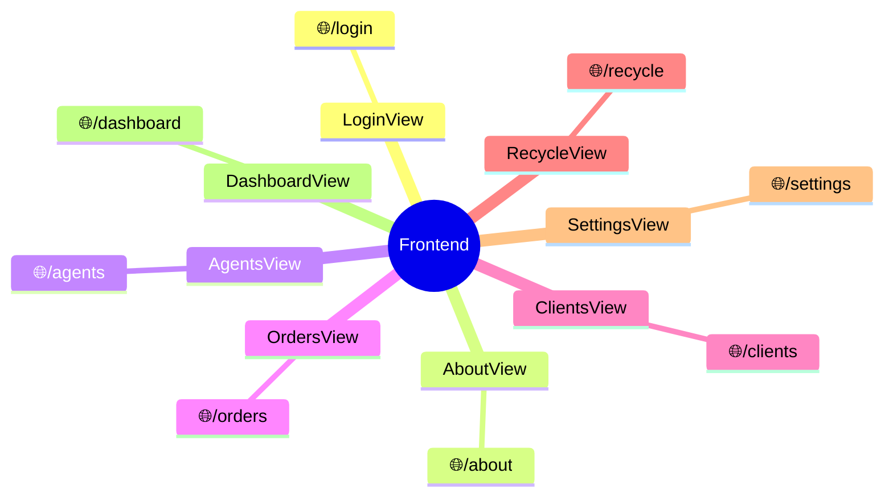
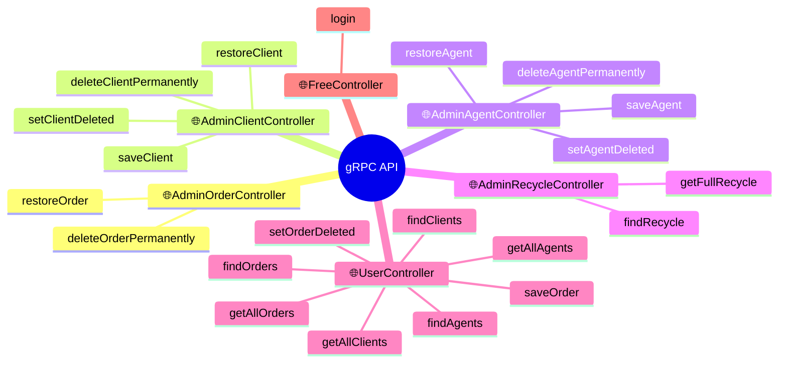

## Service Desk


---

<span>
<a href="./README.md">Русский</a> | English
</span>

---

Distributed web application SPA + API for managing orders, clients, employees, as well as implementing three-stage deadline control.

### UI screenshots

<details>

<summary>Look</summary>


</details>

The interface theme adapts to your browser's theme.

### Main functions
Only the checked features have been implemented:
- [x] Employee management
- [x] Client management
- [x] Management of client orders and which employee is handling the order
- [x] Recycle bin for deleted items with the ability to restore
- [x] Traffic lights to indicate order status
- [x] Admin / user roles and login form
- [x] Dashboard with order statistics
- [ ] Function for sending email notifications when a new order is created
- [ ] Function for creating a new order via email

### Modules
- Backend (Hibernate, Postgres)
- Frontend (Vaadin UI)

Modules interact with each other via gRPC (HTTP-2)

### Color-coded statuses
-  New order request (NEW)
-  It's time to start working on it (IN PROGRESS)
-  It's time to check the initial stage (FIRST CONTROL)
-  It's time to check the final stage (SECOND CONTROL)
-  The work on the request is finished (COMPLETED)

In the calendar, a purple marker indicates the deadline:
-  Deadline (DEADLINE)

### Requirements
Before you begin, make sure the following is installed:

| Tool           | Version                              | Check                  |
|----------------|--------------------------------------|------------------------|
| Docker Desktop | 4.x+                                 | docker --version       |
| Docker Compose | v2+                                  | docker compose version |
| JDK            | 25                                   | java -version          |
| Maven          | 3.9+                                 | mvn -version           |
| Node.js        | 20+ (for local assembling of Vaadin) | node -v                |
| Git            | any                                  | git --version          |

### Running the Application Locally

Open a terminal and run the commands to start the application.

**1. Clone the project**

```bash
git clone https://github.com/AleksOBM/vaadin-service-desk.git
```

**2. Go to the project root**

```bash
cd vaadin-service-desk
```

**3. Launch**

The first launch will take a while (5-15 minutes).
An internet connection is required to download third-party libraries and images.

```bash
docker compose up --build -d
```

**4. Configure the certificate (optional)**

The access certificate is already available. Export it using your browser and add it to the trusted certificates.

<details>

<summary>How to do this</summary>

4.1 After starting the application, open Chrome at https://localhost:8080.

<details>
<summary>A warning page will appear</summary>

</details>

4.2 Click the warning, then click "Certificate details".

<details>
<summary>The certificate viewer will appear</summary>


</details>

4.3 In the certificate details, open the "Details" tab and click "Export" at the bottom.

<details>
<summary>A file save dialog will appear</summary>


</details>

4.4 Add the exported certificate to your browser's trusted certificates.

4.4.1 Enter this address in the address bar:
`chrome://certificate-manager/localcerts/usercerts`

<details>
<summary>The certificate manager will appear</summary>

</details>

4.4.2 Click "Import".

<details>
<summary>A file selection dialog will appear</summary>

</details>

4.4.3 Select the certificate file and click "Open".

<details>
<summary>The certificate has been imported; you can delete the file</summary>

</details>

4.5 Restart Chrome.

</details>

**5. Use the application**

**If the certificate is configured**

Open your browser at https://localhost:8080.

<details>
<summary>View</summary>

</details>

**If the certificate is not configured**

Open your browser at https://localhost:8080 and ignore the browser's certificate warning.

<details>
<summary>Ignore the browser's certificate warning</summary>

When you first open the page, the browser will display a **"Your connection is not private"** warning.

<details>
<summary>View</summary>

</details>

**This is expected when running on a local network.**

The project uses a self-signed certificate, which browsers do not trust by default.
However, the traffic is still encrypted.

**What to do:** click "Advanced" → "Proceed to localhost (unsafe)".

For deployment on the public internet, use a certificate issued by a trusted CA to avoid this warning.
</details>

**6. Stop**

Keeping the data

```bash
docker compose down
```

Without keeping the data

```bash
docker compose down -v
```

**7. Relaunch**

```bash
docker compose up -d
```

**8. Complete removal**

```bash
docker compose down -v --rmi all
```

### Frontend REST endpoints


### Backend gRPC endpoints


### Database map

