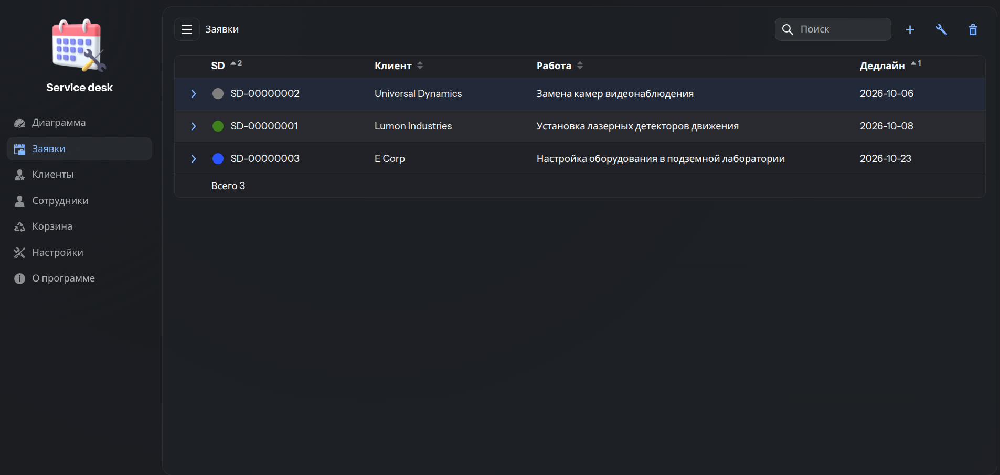
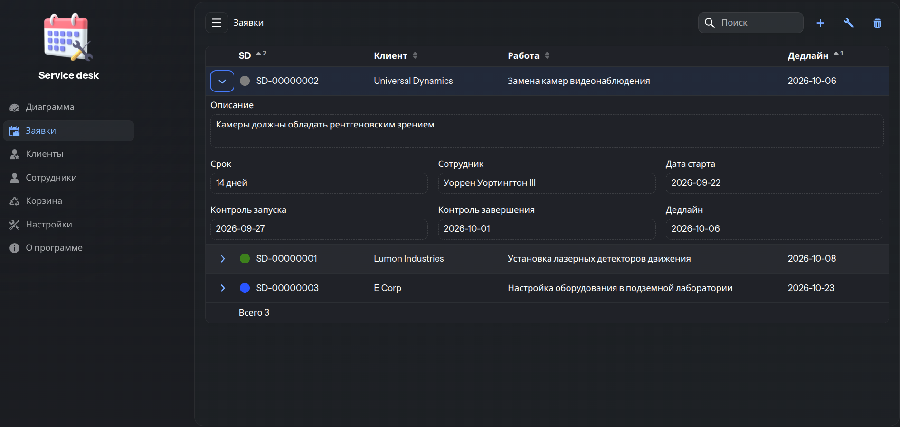
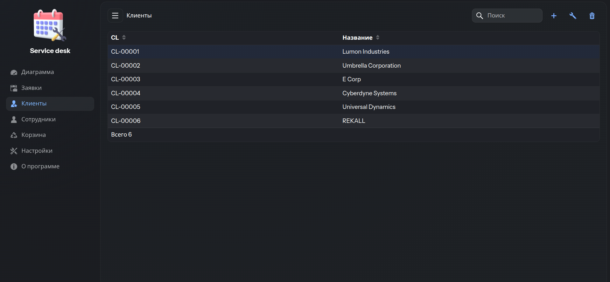
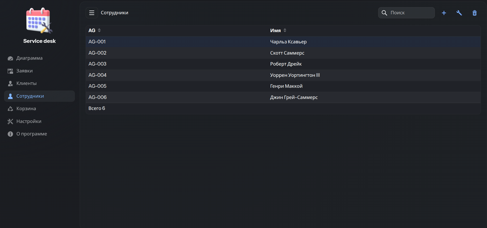
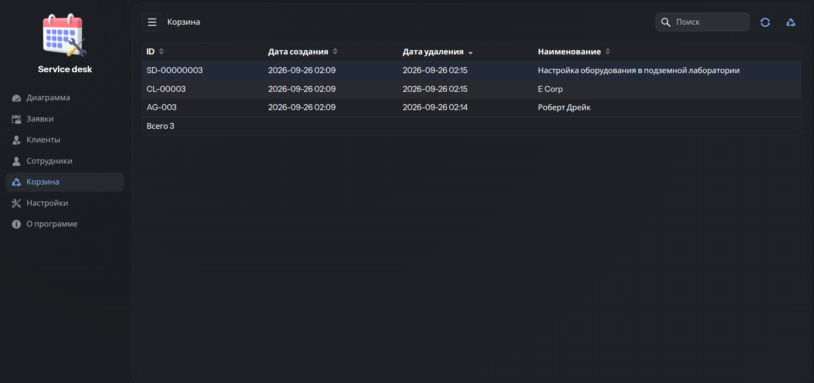
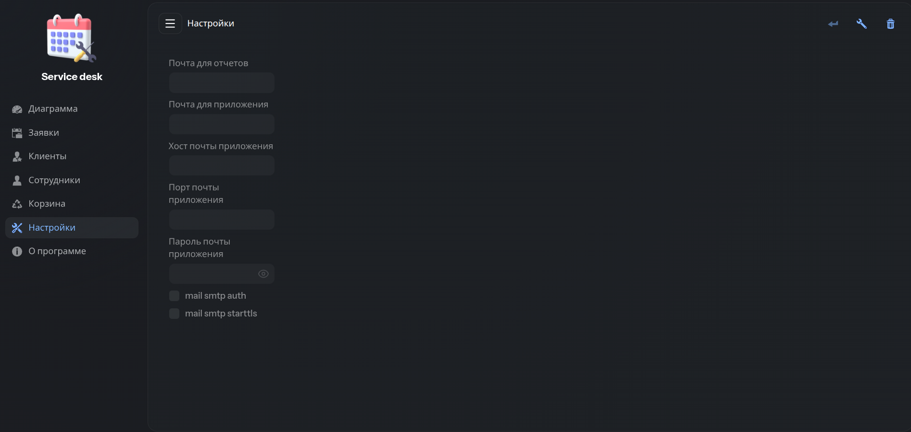
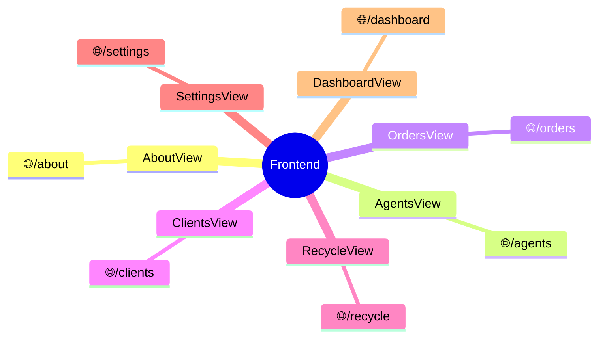
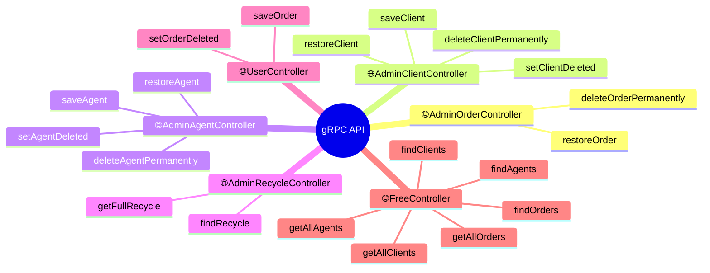
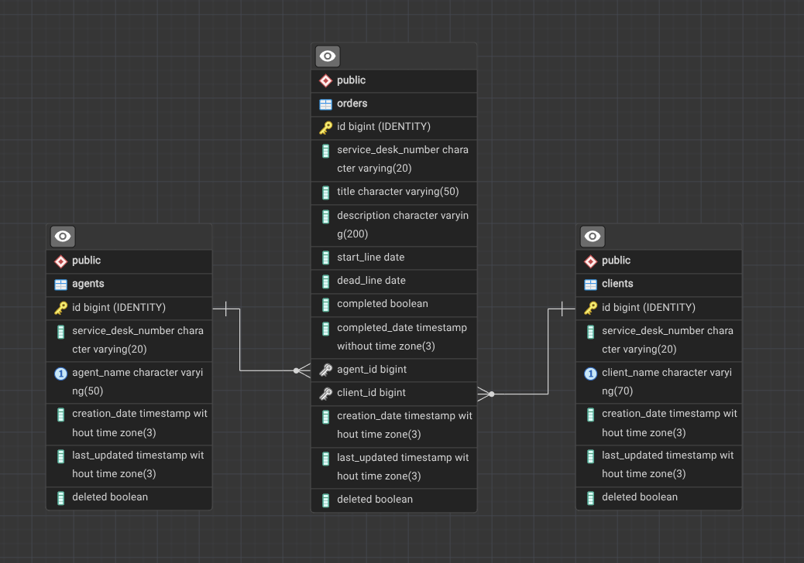

## Service Desk


---

<span>
<a href="./README.md">Русский</a> | English
</span>

---

Distributed web application SPA + API for managing orders, clients, employees, as well as implementing three-stage deadline control.

### UI screenshots








### Main functions
Only the checked ones have been implemented
- [x] Employee management
- [x] Client management
- [x] Management of client orders and which employee is handling the order
- [x] Recycle bin for deleted items with the ability to restore
- [x] Traffic lights to indicate order status
- [ ] Admin / user roles and login form
- [ ] Dashboard with orders statistics
- [ ] Function for sending email notifications when a new order is created
- [ ] Function for creating a new order via email

### Modules
- Backend (Hibernate, Postgres)
- Frontend (Vaadin UI)

Modules interact with each other via gRPC (HTTP-2)

### Color-coded statuses
-  New order request (NEW)
-  It's time to start working on it (IN PROGRESS)
-  It's time to check the initial stage (FIRST CONTROL)
-  It's time to check the final stage (SECOND CONTROL)
-  The work on the request is finished (COMPLETED)

### Environmental Requirements
Before you begin, make sure the following is installed:

| Tool           | Version                              | Check                  |
|----------------|--------------------------------------|------------------------|
| Docker Desktop | 4.x+                                 | docker --version       |
| Docker Compose | v2+                                  | docker compose version |
| JDK            | 25                                   | java -version          |
| Maven          | 3.9+                                 | mvn -version           |
| Node.js        | 20+ (for local assembling of Vaadin) | node -v                |
| Git            | любая                                | git --version          |

### Running the Application on local host

Open a terminal and run the commands to start the application.

**1. Clone the project**

```bash
git clone https://github.com/AleksOBM/vaadin-service-desk.git
```

**2. Go to the project root**

```bash
cd vaadin-service-desk
```

**3. Launch**

The first launch will take a long time, 5-15 min.
An internet connection is required to download third-party libraries and images.

```bash
docker compose up --build -d
```

**4. Usage**

Open your browser at the page http://localhost:8080

**5. Stop**

Keeping the data

```bash
docker compose down
```

Without keeping the data

```bash
docker compose down -v
```

**6. Relaunch**

```bash
docker compose up -d
```

**7. Complete removal**

```bash
docker compose down -v --rmi all
```

### Frontend REST endpoints


### Backend gRPC endpoints


### Database map

