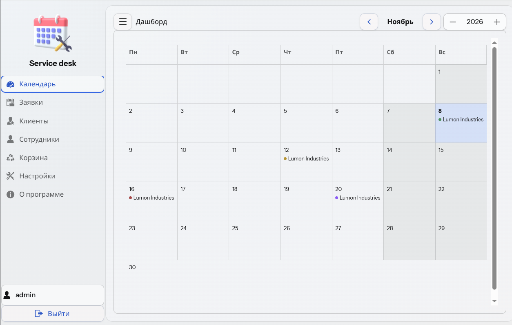
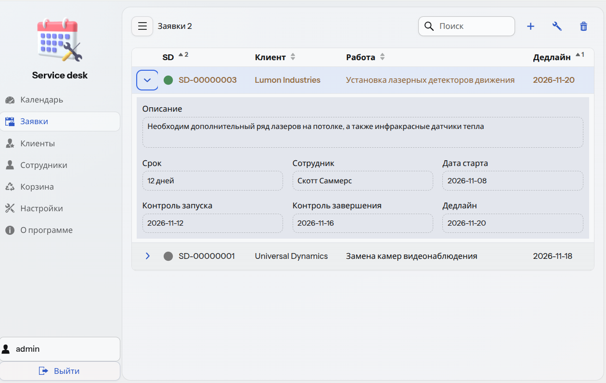
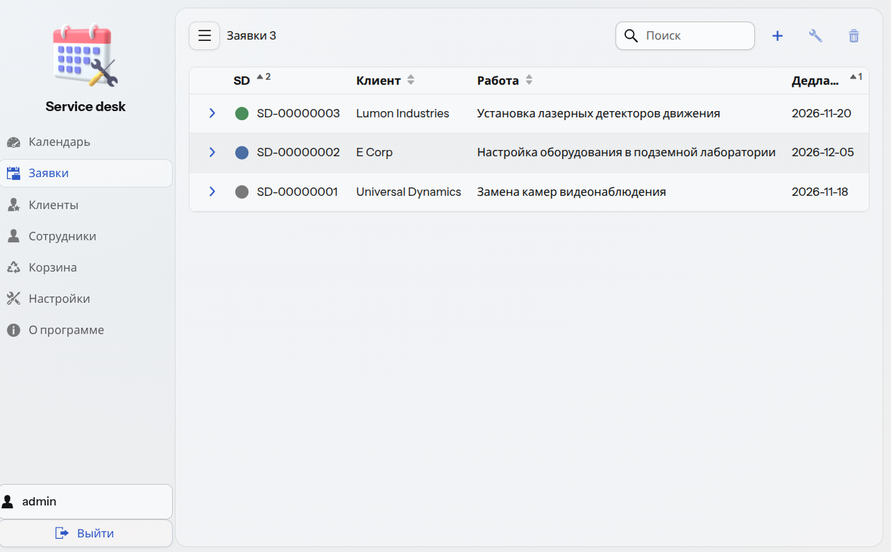
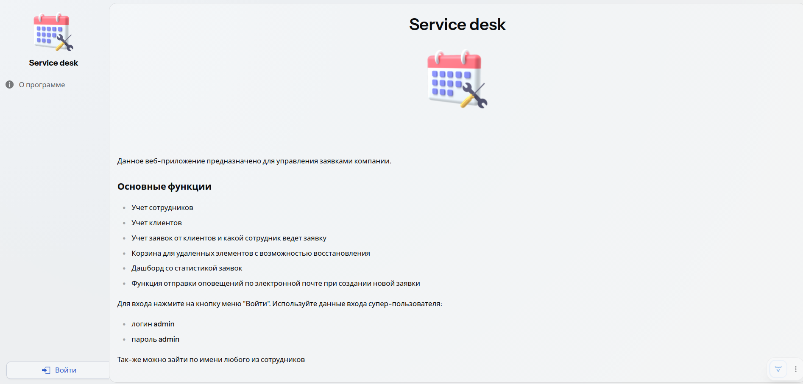
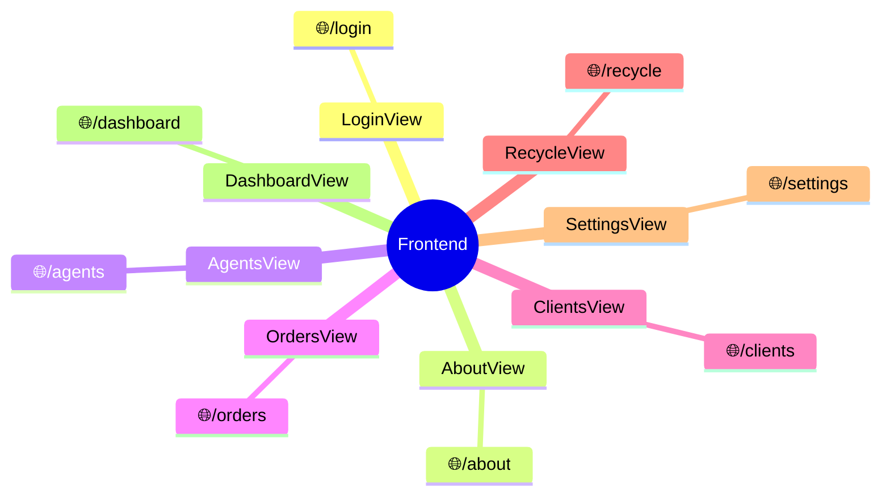
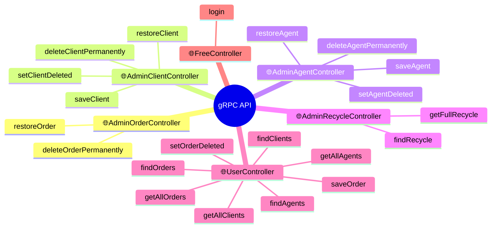
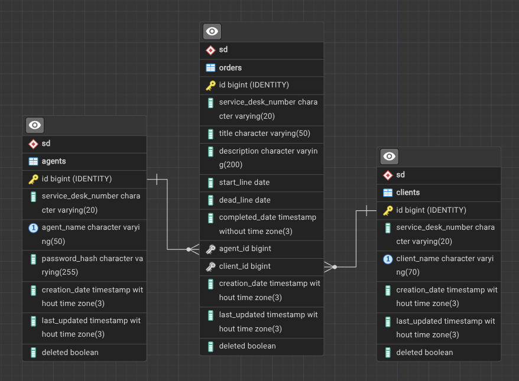

## Service Desk


---

<span>
Русский | <a href="./README.en.md">English</a>
</span>

---

Распределённое веб-приложение SPA + API для учёта заказов, клиентов, сотрудников, а также осуществления трёхступенчатого контроля дедлайнов.

### Скриншоты пользовательского интерфейса

<details>

<summary>Посмотреть</summary>






</details>

Тема интерфейса подстраивается под тему вашего браузера

### Основные функции
Реализованы только отмеченные
- [x] Учет сотрудников
- [x] Учет клиентов
- [x] Учет заявок от клиентов и какой сотрудник ведет заявку
- [x] Корзина для удаленных элементов с возможностью восстановления
- [x] Светофоры для обозначения статуса заказа
- [x] Роли админ / пользователь и форма входа 
- [ ] Дашборд со статистикой заявок
- [ ] Функция отправки оповещений по электронной почте при создании новой заявки
- [ ] Функция создания новой заявки с помощью письма электронной почты

### Модули
- Backend (Hibernate, Postgres)
- Frontend (Vaadin UI)

Взаимодействие модулей между собой осуществляется по gRPC (HTTP-2)

### Статусы светофоров
-  Новая заявка (NEW)
-  Пришло время начать выполнение (IN PROGRESS)
-  Пришло время проконтролировать начальную стадию (FIRST CONTROL)
-  Пришло время проконтролировать завершающую стадию (SECOND CONTROL)
-  Работа по заявке окончена (COMPLETED)

### Требования для запуска
Перед началом убедитесь, что установлено:

| Инструмент     | Версия                            | Проверка               |
|----------------|-----------------------------------|------------------------|
| Docker Desktop | 4.x+                              | docker --version       |
| Docker Compose | v2+                               | docker compose version |
| JDK            | 25                                | java -version          |
| Maven          | 3.9+                              | mvn -version           |
| Node.js        | 20+ (для локальной сборки Vaadin) | node -v                |
| Git            | любая                             | git --version          |

### Запуск приложения на локальной машине

Откройте терминал и выполните команды для запуска приложения.

**1. Склонировать проект**

```bash
git clone https://github.com/AleksOBM/vaadin-service-desk.git
```

**2. Перейти в корень проекта**

```bash
cd vaadin-service-desk
```

**3. Запуск**

Первый запуск будет долгим 5-15 мин.  
Необходим интернет для скачивания сторонних библиотек и образов.  

```bash
docker compose up --build -d
```

**4. Использование**

Откройте браузер на странице https://localhost:8080

**5. Остановка**

С сохранением данных

```bash
docker compose down
```

Без сохранения данных

```bash
docker compose down -v
```

**6. Повторный запуск**

```bash
docker compose up -d
```

**7. Полное удаление**

```bash
docker compose down -v --rmi all
```

### ⚠️ Предупреждение браузера о сертификате

При первом открытии страницы браузер покажет предупреждение **«Подключение не защищено»**.

**Это нормально для работы в локальной сети.**  
Проект использует самоподписанный сертификат, которому браузеры по умолчанию не доверяют.
При этом трафик всё равно шифруется.

**Что делать:** нажмите «Дополнительно» → «Перейти на localhost (небезопасно)».

Для работы в глобальной сети необходимо использовать сертификат от доверенного CA, тогда предупреждения не будет.

### REST эндпоинты фронтенда


### gRPC эндпоинты бэкенда


### Схема базы данных

